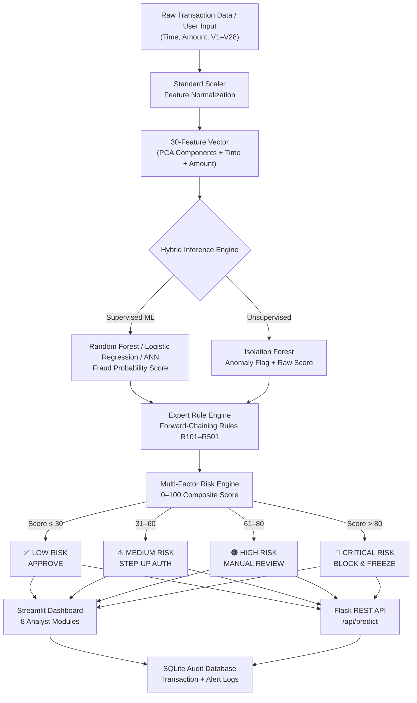

# 🏦 SecureBank AI — Banking Fraud Detection Intelligence System

<div align="center">

[](https://www.python.org/)
[](https://streamlit.io/)
[](https://flask.palletsprojects.com/)
[](https://scikit-learn.org/)
[](https://www.tensorflow.org/)
[](LICENSE)

<br/>

**An enterprise-grade, hybrid AI-powered Banking Fraud Intelligence & Risk Analysis Platform.**  
Detects fraudulent credit card transactions in real-time using ensemble machine learning, unsupervised anomaly detection, SHAP explainability, and graph-based fraud ring analytics — all behind a modern dark-themed Streamlit dashboard and a production-ready Flask REST API.

<br/>

🔗 **Live Demo:** [bank-fraud-detection-ai.streamlit.app](https://bank-fraud-detection-ai.streamlit.app/)

</div>

---

## 📌 Executive Summary

Financial fraud costs institutions **billions of dollars annually**. Detecting fraudulent transactions is uniquely challenging due to:

- **Extreme class imbalance** — fewer than 0.2% of transactions are fraudulent
- **Anonymized feature space** — PCA-transformed components (V1–V28) protecting cardholder identity
- **Real-time latency requirements** — decisions must be made in milliseconds

**SecureBank AI v2.0.0** addresses these challenges head-on with a **hybrid intelligence architecture** that combines:

| Layer | Technology |
|:---|:---|
| Supervised Classification | Random Forest, Logistic Regression, TensorFlow ANN |
| Unsupervised Detection | Isolation Forest anomaly scoring |
| Expert Reasoning | Forward-chaining rule engine (R101, R102, R201, R501) |
| Multi-Factor Risk Scoring | 3-component weighted risk engine (0–100 scale) |
| Explainability | SHAP TreeExplainer — per-feature Shapley attribution |
| Graph Intelligence | NetworkX BFS/DFS fraud ring detection |
| Temporal Forecasting | Holt-Winters 48-hour fraud trend forecasting |

---

## ✨ Key Features

- 📊 **Executive Intelligence Dashboard** — Real-time KPI cards, transaction volume, risk distribution, and live audit feed
- 🔍 **Real-Time Fraud Predictor** — Single-transaction scoring with 1-click test presets and bulk CSV batch inference
- ⚡ **Multi-Factor Risk Engine** — Composite 0–100 risk score blending ML confidence, anomaly signals, and monetary exposure
- 🧠 **Explainable AI (SHAP)** — Shapley value waterfall/bar charts revealing *why* each prediction was made
- 🚨 **Analyst Alert Queue** — Triage dashboard: approve, block, or flag false positives with persistent audit logging
- 📈 **Fraud Trend Forecasting** — 48-hour diurnal pattern analysis with Holt-Winters extrapolation
- 🕵️ **Graph Investigation** — NetworkX-powered fraud ring and relationship mapping (BFS/DFS traversal)
- 📉 **Model Benchmarking** — Side-by-side performance comparison across all trained classifiers
- 🌐 **Flask REST API** — Production backend with health checks, single/batch prediction endpoints, and model inventory
- 🐳 **DevContainer Ready** — Zero-config VS Code `.devcontainer` for instant environment reproduction

---

## 🏗️ System Architecture



---

## 📊 Machine Learning Model Benchmarks

Models were trained on **SMOTE-oversampled** training data with `StandardScaler` preprocessing. All evaluation metrics reflect the **original imbalanced test distribution** — raw accuracy is intentionally *not* the primary signal.

> 💡 **Evaluation Philosophy:** With a fraud rate of ~0.173%, a naïve "always-legitimate" classifier achieves 99.83% accuracy. **F1-Score, Recall, and ROC-AUC** are the meaningful metrics.

| Model | Accuracy | Precision | Recall | F1-Score | ROC-AUC | Train Time |
|:---|:---:|:---:|:---:|:---:|:---:|:---:|
| 🌲 **Random Forest** *(Production)* | **99.90%** | **0.6727** | **0.7789** | **0.7220** | **0.9811** | 48.17s |
| ⚡ KNN Classifier | 99.80% | 0.4425 | 0.8105 | 0.5725 | 0.9100 | 0.08s |
| 🌳 Decision Tree | 98.56% | 0.0829 | 0.7579 | 0.1495 | 0.8163 | 44.73s |
| 📈 Logistic Regression | 97.37% | 0.0530 | 0.8737 | 0.1000 | 0.9626 | 1.98s |
| 🧠 TensorFlow ANN | — | — | — | — | — | Experimental |
| 🔎 Isolation Forest | — | — | — | — | 0.9342 | Anomaly only |

> **Why Random Forest?** It achieves the best balance of Precision and Recall (F1 = **0.722**) with an ROC-AUC of **0.9811** — dramatically reducing costly false positives compared to Logistic Regression, while maintaining strong fraud recall.

---

## ⚙️ Risk Scoring Engine

The **Multi-Factor Risk Engine** (`src/risk_engine.py`) combines three independent signals into a single calibrated 0–100 risk score:

```
Risk Score = ML_component (65%) + Anomaly_component (20%) + Monetary_component (15%)
```

| Component | Weight | Calculation |
|:---|:---:|:---|
| Supervised ML Probability | **65%** | `fraud_probability × 100 × 0.65` |
| Isolation Forest Anomaly | **20%** | 12 base pts + severity bonus when flagged |
| Transaction Amount (USD) | **15%** | >$5,000 = 15 pts · >$1,500 = 10 pts · >$500 = 5 pts |

| Score Range | Risk Level | Action Code | Response |
|:---:|:---:|:---:|:---|
| 0 – 30 | 🟢 **Low** | `APPROVE` | Normal monitoring, auto-cleared |
| 31 – 60 | 🟡 **Medium** | `STEP_UP_AUTH` | Trigger 2FA / OTP verification |
| 61 – 80 | 🟠 **High** | `MANUAL_REVIEW` | Priority analyst review + hold |
| 81 – 100 | 🔴 **Critical** | `BLOCK` | Immediately block + freeze card |

### Expert Rule Engine

The forward-chaining rule engine fires deterministic alerts over model outputs:

| Rule ID | Trigger | Severity |
|:---:|:---|:---:|
| `R101` | Fraud probability ≥ 0.95 | 🔴 CRITICAL |
| `R102` | Fraud probability ≥ 0.80 | 🟠 HIGH |
| `R201` | Isolation Forest anomaly flag raised | 🟠 HIGH |
| `R501` | ML fraud prediction **AND** anomaly flag both triggered | 🔴 CRITICAL |

---

## 📁 Repository Structure

```
Banking Fraud Dtection Model/
│
├── 📱 app.py                           # Streamlit main portal (home page & KPI hub)
├── 📋 requirements.txt                 # Streamlit frontend dependencies
├── 📋 pyproject.toml                   # Pyrefly type-checker source path config
├── 📋 pytest.ini                       # Pytest root configuration
│
├── 📂 pages/                           # Streamlit multi-page modules
│   ├── 1_Executive_Dashboard.py        # KPIs, volume charts, risk distribution
│   ├── 2_Fraud_Prediction.py           # Single transaction & bulk CSV inference
│   ├── 3_Risk_Anomaly_Analysis.py      # Multi-factor risk deep-dive
│   ├── 4_Explainable_AI_(SHAP).py      # SHAP waterfall & bar attribution charts
│   ├── 5_Fraud_Alerts_Queue.py         # Analyst triage & audit logging
│   ├── 6_Fraud_Trend_Forecasting.py    # 48h Holt-Winters trend forecasting
│   ├── 7_Investigation.py              # NetworkX graph fraud ring detector
│   └── 8_Model_Comparison.py          # Side-by-side classifier benchmarks
│
├── 📂 src/                             # Shared Python services (Streamlit-side)
│   ├── prediction.py                   # Model loading & inference pipeline
│   ├── risk_engine.py                  # 3-factor 0–100 risk scoring engine
│   ├── anomaly.py                      # Isolation Forest wrapper
│   ├── explainability.py               # SHAP value computation
│   ├── alerts.py                       # Alert generation & DB persistence
│   ├── rules.py                        # Forward-chaining expert rule engine
│   ├── graph_analysis.py               # NetworkX BFS/DFS graph analytics
│   └── database.py                     # SQLite KPI queries
│
├── 📂 backend/                         # Flask REST API (production backend)
│   ├── run.py                          # Development server entry point
│   ├── wsgi.py                         # Gunicorn WSGI production entry point
│   ├── .env.example                    # Environment variable template
│   ├── requirements.txt                # Backend-specific dependencies
│   │
│   └── 📂 app/
│       ├── __init__.py                 # Application factory (create_app)
│       ├── config.py                   # Dev / Testing / Production config classes
│       ├── extensions.py               # Flask extensions: db, cors, migrate
│       │
│       ├── 📂 routes/
│       │   ├── health_routes.py        # GET  /api/health
│       │   ├── prediction_routes.py    # POST /api/predict
│       │   ├── model_routes.py         # GET  /api/models  &  /api/models/compare
│       │   ├── alert_routes.py         # Fraud alert CRUD
│       │   └── analytics_routes.py     # Operational summary statistics
│       │
│       ├── 📂 services/
│       │   ├── prediction_service.py   # Core single & batch inference pipeline
│       │   ├── risk_engine.py          # API-side risk score computation
│       │   ├── anomaly_service.py      # Isolation Forest scoring adapter
│       │   ├── explainability_service.py # SHAP TreeExplainer integration
│       │   ├── forecasting_service.py  # Holt-Winters trend aggregation
│       │   ├── analytics_service.py    # DB-backed analytics queries
│       │   ├── alert_service.py        # Alert persistence & retrieval
│       │   ├── preprocessing_service.py# Feature alignment & StandardScaler
│       │   └── rule_engine.py          # Expert rule engine (R101–R501)
│       │
│       ├── 📂 models/
│       │   ├── database_models.py      # SQLAlchemy ORM: Transaction, FraudAlert
│       │   └── schemas.py              # Pydantic request validation schemas
│       │
│       ├── 📂 utils/
│       │   ├── model_loader.py         # Artifact registry with lazy caching
│       │   ├── validators.py           # Input validation helpers
│       │   ├── helpers.py              # JSON error responses & ID generation
│       │   └── metrics_seed.py         # CSV → SQLite model metadata seeder
│       │
│       └── 📂 tests/
│           ├── conftest.py             # Pytest fixtures: app, client, runner
│           ├── test_api.py             # API endpoint integration tests
│           └── test_prediction.py      # Inference pipeline unit tests
│
├── 📂 models/                          # Trained model artifacts
│   ├── random_forest.pkl               # Primary production classifier
│   ├── logistic_regression.pkl         # Baseline linear classifier
│   ├── scaler.pkl                      # Fitted StandardScaler (30 features)
│   ├── isolation_forest.pkl            # Anomaly detector (n=150)
│   ├── fraud_ann_model.keras           # TensorFlow/Keras deep ANN
│   ├── feature_columns.json            # Canonical ordered feature list
│   └── model_metadata.json             # Version registry & performance stats
│
├── 📂 data/
│   ├── fraud_detection.db              # Primary SQLite database
│   ├── fraud_intelligence.db           # Graph intelligence database
│   ├── 📂 processed/                   # Train/test split CSVs
│   │   └── hourly_fraud_trends.csv     # Temporal fraud aggregations
│   └── 📂 sample/                      # Sample transaction files
│
├── 📂 Notebook/                        # Research & development notebooks
│   ├── EDA.ipynb                       # Exploratory data analysis
│   ├── Data_Preprocessing.ipynb        # SMOTE + StandardScaler pipeline
│   ├── ML_ALGO.ipynb                   # ML model training & evaluation
│   ├── 05_TimeSeriesAnalysis.ipynb     # Temporal fraud pattern analysis
│   ├── 06_AnomalyDetection.ipynb       # Isolation Forest tuning
│   └── 07_ExplainableAI.ipynb         # SHAP analysis deep-dive
│
├── 📂 outputs/
│   ├── 📂 metrics/                     # Saved evaluation CSVs
│   └── 📂 figures/                     # Generated charts & plots
│
├── 📂 scripts/
│   └── train_ann.py                    # TensorFlow ANN training script
│
└── 📂 .devcontainer/
    └── devcontainer.json               # VS Code Dev Container configuration
```

---

## 🚀 Quick Start Guide

### Prerequisites

- **Python 3.10+** (3.11 recommended)
- **Git**
- Dataset: [Kaggle Credit Card Fraud Detection](https://www.kaggle.com/mlg-ulb/creditcardfraud) → place at `Dataset/creditcard.csv`

---

### Step 1 — Clone the Repository

```bash
git clone https://github.com/Utsav-Saha/Bank-Fraud-Detection-AI.git
cd Bank-Fraud-Detection-AI
```

---

### Step 2 — Create & Activate Virtual Environment

**Windows (PowerShell):**
```powershell
python -m venv venv
.\venv\Scripts\Activate.ps1
```

**macOS / Linux:**
```bash
python3 -m venv venv
source venv/bin/activate
```

---

### Step 3 — Install Dependencies

**Streamlit Frontend:**
```bash
pip install --upgrade pip
pip install -r requirements.txt
```

**Flask Backend (optional — for REST API):**
```bash
pip install -r backend/requirements.txt
```

---

### Step 4A — Launch the Streamlit Dashboard

```bash
streamlit run app.py
```

> Opens automatically at **http://localhost:8501**

---

### Step 4B — Launch the Flask REST API

```bash
# Configure environment
cp backend/.env.example backend/.env
# Edit backend/.env with your SECRET_KEY and settings

# Development server
cd backend
python run.py
```

> API available at **http://localhost:5000**

**Production (Gunicorn):**
```bash
cd backend
gunicorn --workers 4 --bind 0.0.0.0:5000 wsgi:app
```

---

### Dev Container (VS Code)

This project ships with a `.devcontainer/devcontainer.json` for one-click containerized development:

1. Install the **Dev Containers** extension in VS Code
2. Open the project folder → `Ctrl+Shift+P` → **Reopen in Container**
3. Environment is configured automatically — no manual setup required

---

## 💻 Platform Modules

### 📊 1. Executive Dashboard
Real-time KPI cards (total transactions, fraud incidents, portfolio fraud rate, active alert queue), monetary volume distribution charts, and a live transaction audit feed.

### 🔍 2. Real-Time Fraud Predictor
- **Single Mode**: Enter transaction features (Time, Amount, V1–V28) and receive instant fraud classification, risk score, anomaly flag, and triggered rule alerts
- **Batch CSV Upload**: Upload any test CSV for bulk inference with downloadable scored results

### ⚡ 3. Risk & Anomaly Analysis
Deep-dive into the 3-factor risk engine — visualize how ML confidence, anomaly severity, and monetary exposure combine into the final risk score.

### 🧠 4. Explainable AI (SHAP)
SHAP `TreeExplainer` Shapley value attribution — waterfall and bar charts identifying the exact features that pushed a transaction toward or away from the fraud class.

### 🚨 5. Fraud Alerts Queue
Interactive analyst triage interface. Review flagged transactions, approve legitimate ones, block confirmed fraud, or mark false positives — with full persistent audit logging.

### 📈 6. Fraud Trend Forecasting
48-hour temporal analysis over the dataset's time horizon. Highlights diurnal night-time fraud rate spikes and projects short-horizon trends using Holt-Winters exponential smoothing.

### 🕵️ 7. Graph Investigation
NetworkX-powered transaction relationship explorer. BFS/DFS traversal maps potential fraud rings and shared entity linkages across transaction histories.

### 📉 8. Model Comparison
Side-by-side performance table and charts for all trained classifiers — Accuracy, Precision, Recall, F1-Score, ROC-AUC, PR-AUC, and training time trade-offs.

---

## 📡 REST API Reference

**Base URL:** `http://localhost:5000/api`

### Health Check

```http
GET /api/health
```

```json
{
  "status": "ok",
  "service": "banking-fraud-detection-api",
  "environment": "development",
  "database": "connected",
  "models": [...],
  "missing_required": []
}
```

---

### Predict — Single Transaction

```http
POST /api/predict
Content-Type: application/json
```

**Request Body:**

```json
{
  "model": "random_forest",
  "threshold": 0.5,
  "already_scaled": false,
  "transaction": {
    "Time": 0.0,
    "V1": -1.3598071, "V2": -0.0727811, "V3": 2.5363467,
    "V4": 1.3781552,  "V5": -0.3383208, "V6": 0.4623878,
    "V7": 0.2395985,  "V8": 0.0986979,  "V9": 0.3637869,
    "V10": 0.0907941, "V11": -0.5515995,"V12": -0.6178009,
    "V13": -0.9913898,"V14": -0.3111694,"V15": 1.4681770,
    "V16": -0.4704005,"V17": 0.2079708, "V18": 0.0257905,
    "V19": 0.4039936, "V20": 0.2514120, "V21": -0.0183067,
    "V22": 0.2778375, "V23": -0.1104739,"V24": 0.0669280,
    "V25": 0.1285394, "V26": -0.1891148,"V27": 0.1335583,
    "V28": -0.0210530,"Amount": 149.62
  }
}
```

**Supported `model` values:** `random_forest` · `logistic_regression` · `ann`

**Response:**

```json
{
  "transaction_id": "TXN-a1b2c3d4",
  "model": "random_forest",
  "prediction": 0,
  "prediction_label": "Legitimate",
  "fraud_probability": 0.034215,
  "classification_threshold": 0.5,
  "risk_score": 3.42,
  "risk_level": "Low",
  "recommendation": "Normal monitoring",
  "anomaly_flag": 0,
  "anomaly": { "anomaly_flag": 0, "raw_score": -0.182, "normalized_score": 0.182 },
  "alerts": [],
  "triggered_rules": [],
  "inference_time_ms": 11.3
}
```

---

### Model Inventory & Comparison

| Method | Endpoint | Description |
|:---:|:---|:---|
| `GET` | `/api/models` | List all registered model artifacts and availability status |
| `GET` | `/api/models/compare` | Performance metrics comparison across all trained models |

---

## ⚙️ Configuration

Create `backend/.env` from the provided template:

```bash
cp backend/.env.example backend/.env
```

| Variable | Default | Description |
|:---|:---|:---|
| `FLASK_ENV` | `development` | `development` · `testing` · `production` |
| `FLASK_DEBUG` | `1` | Enable debug mode (`0` in production) |
| `SECRET_KEY` | *(must change)* | Strong random secret — required in production |
| `DATABASE_URL` | SQLite `data/fraud_detection.db` | Database connection URI |
| `CORS_ORIGINS` | `http://localhost:5173` | Comma-separated allowed CORS origins |
| `MODELS_DIR` | `models/` | Path to trained model artifacts |
| `FRAUD_THRESHOLD` | `0.5` | Default classification decision threshold |
| `MAX_CONTENT_LENGTH` | `10485760` (10 MB) | Max upload file size in bytes |

> ⚠️ **Production Warning:** `ProductionConfig` raises a `RuntimeError` at startup if `SECRET_KEY` is left at its default value. Always set a strong secret before deploying.

---

## 🧪 Running Tests

```bash
# From project root
pytest

# Verbose output with coverage
cd backend
pytest tests/ -v
```

The test suite uses an **in-memory SQLite** database (`TestingConfig`) for fast, isolated execution:

| File | Coverage |
|:---|:---|
| `tests/conftest.py` | Shared fixtures: `app`, `client`, `runner` |
| `tests/test_api.py` | API endpoint integration tests |
| `tests/test_prediction.py` | Inference pipeline unit tests |

---

## 📓 Research Notebooks

| Notebook | Description |
|:---|:---|
| `Notebook/EDA.ipynb` | Class distribution, PCA component analysis, correlation heatmaps |
| `Notebook/Data_Preprocessing.ipynb` | SMOTE oversampling, StandardScaler pipeline, train/test split |
| `Notebook/ML_ALGO.ipynb` | Training RF, LR, DT, KNN; full evaluation metrics & confusion matrices |
| `Notebook/05_TimeSeriesAnalysis.ipynb` | Hourly fraud rate patterns, diurnal anomaly spikes |
| `Notebook/06_AnomalyDetection.ipynb` | Isolation Forest hyperparameter tuning and ROC analysis |
| `Notebook/07_ExplainableAI.ipynb` | SHAP waterfall, summary, and beeswarm plots |

### Train the TensorFlow ANN

```bash
python scripts/train_ann.py
```

**Outputs generated:**
- `models/fraud_ann_model.keras` — Saved Keras model
- `outputs/metrics/deep_learning_results.csv` — ANN evaluation report
- `outputs/metrics/ml_dl_comparison.csv` — Combined ML + DL benchmark

---

## 📊 Dataset

**[Kaggle — Credit Card Fraud Detection](https://www.kaggle.com/mlg-ulb/creditcardfraud)**

| Property | Value |
|:---|:---|
| Total Transactions | 284,807 |
| Fraud Cases | 492 |
| Fraud Rate | ~0.173% *(severe class imbalance)* |
| Features | 30 (Time + V1–V28 PCA components + Amount) |
| Labels | `0` = Legitimate · `1` = Fraud |

> **Privacy Note:** Features V1–V28 are **PCA-transformed** to protect cardholder identity. Only `Time` (seconds elapsed) and `Amount` (USD) retain original scale.

> **Dataset not included** in this repository. Download from Kaggle and place at `Dataset/creditcard.csv`.

---

## 🛠️ Technology Stack

### Frontend — Streamlit Dashboard

| Library | Version | Purpose |
|:---|:---:|:---|
| `streamlit` | ≥ 1.30.0 | Multi-page interactive dashboard |
| `pandas` | ≥ 2.0.0 | Data manipulation & CSV processing |
| `numpy` | ≥ 1.24.0 | Numerical computation |
| `scikit-learn` | ≥ 1.3.0 | ML classifiers & StandardScaler |
| `imbalanced-learn` | ≥ 0.11.0 | SMOTE oversampling |
| `tensorflow` | ≥ 2.15.0 | Keras deep learning ANN |
| `shap` | ≥ 0.44.0 | SHAP Shapley value explainability |
| `networkx` | ≥ 3.1 | Graph analytics & fraud ring detection |
| `statsmodels` | ≥ 0.14.0 | Holt-Winters forecasting |
| `plotly` | ≥ 5.18.0 | Interactive charts & visualizations |
| `matplotlib` / `seaborn` | ≥ 3.7 / 0.12 | Static plots & heatmaps |

### Backend — Flask REST API

| Library | Version | Purpose |
|:---|:---:|:---|
| `flask` | ≥ 3.0.0 | REST API framework |
| `flask-sqlalchemy` | ≥ 3.1.0 | ORM & database layer |
| `flask-migrate` | ≥ 4.0.0 | Database schema migrations |
| `flask-cors` | ≥ 4.0.0 | Cross-origin resource sharing |
| `marshmallow` | ≥ 3.21.0 | Serialization & schema validation |
| `pydantic` | — | Request body validation schemas |
| `gunicorn` | ≥ 22.0.0 | WSGI production server |
| `python-dotenv` | ≥ 1.0.0 | `.env` file configuration loading |
| `pytest` | ≥ 8.0.0 | Test framework |

---

## 🤝 Contributing

Contributions, issues, and feature requests are welcome!  
Check the [issues page](https://github.com/Utsav-Saha/Bank-Fraud-Detection-AI/issues) to get started.

1. **Fork** the repository
2. **Create** your feature branch: `git checkout -b feature/AmazingFeature`
3. **Commit** your changes: `git commit -m 'Add AmazingFeature'`
4. **Push** to the branch: `git push origin feature/AmazingFeature`
5. **Open** a Pull Request

---

## 📜 License

Distributed under the **MIT License**. See [`LICENSE`](LICENSE) for more information.

---

<div align="center">
  <br/>
  <strong>SecureBank AI v2.0.0</strong><br/>
  Enterprise Hybrid Fraud Intelligence System<br/>
  <sub>Built with ❤️ by Utsav Saha</sub>
  <br/><br/>

  [](https://www.python.org/)
  [](https://bank-fraud-detection-ai.streamlit.app/)
  [](https://flask.palletsprojects.com/)
  [](https://shap.readthedocs.io/)

</div>
